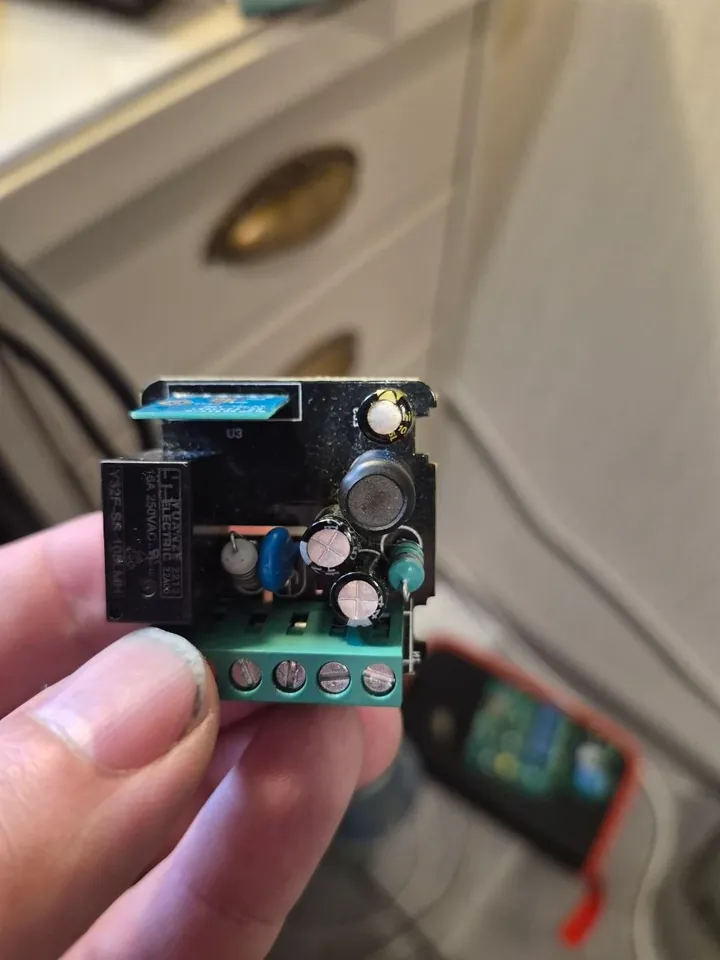
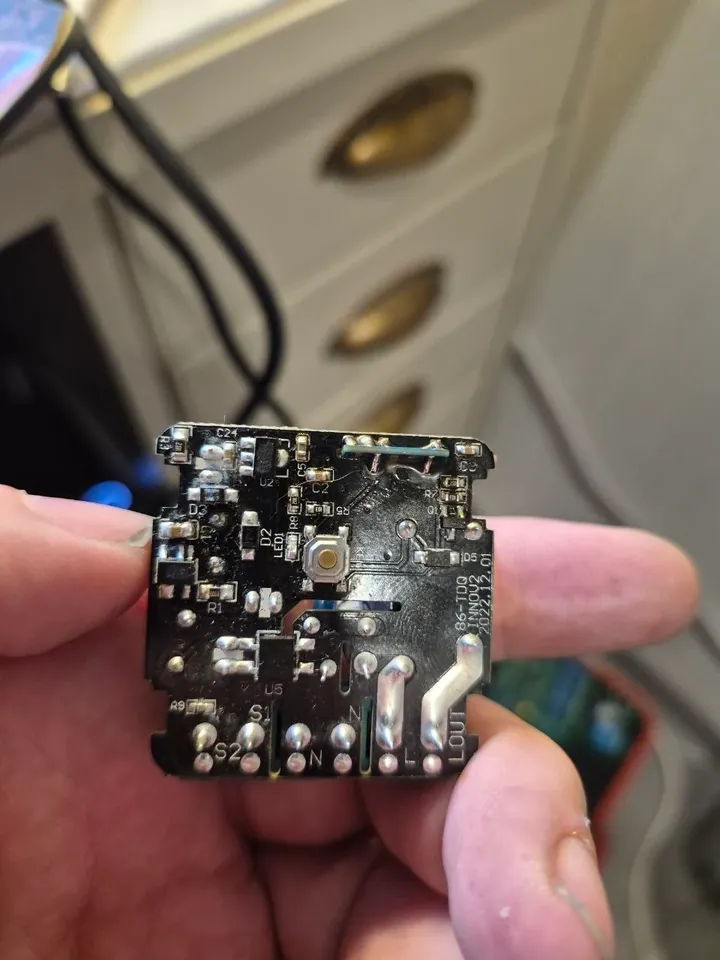
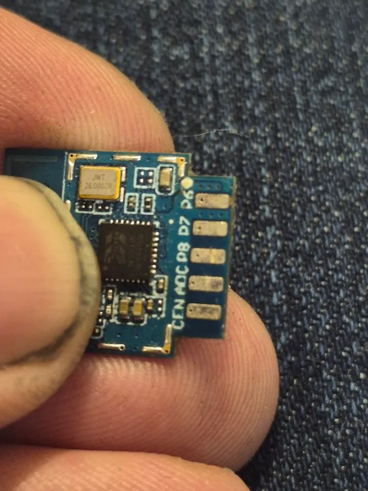
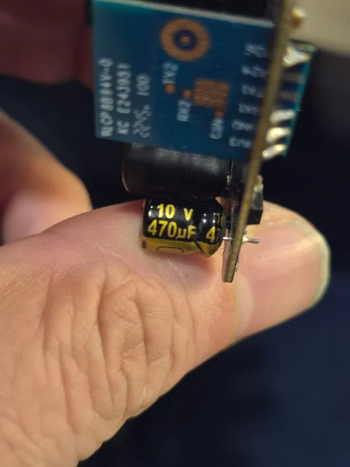
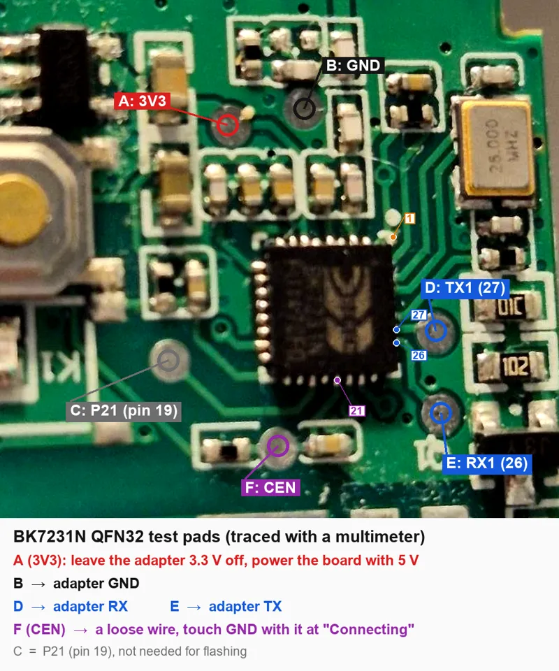
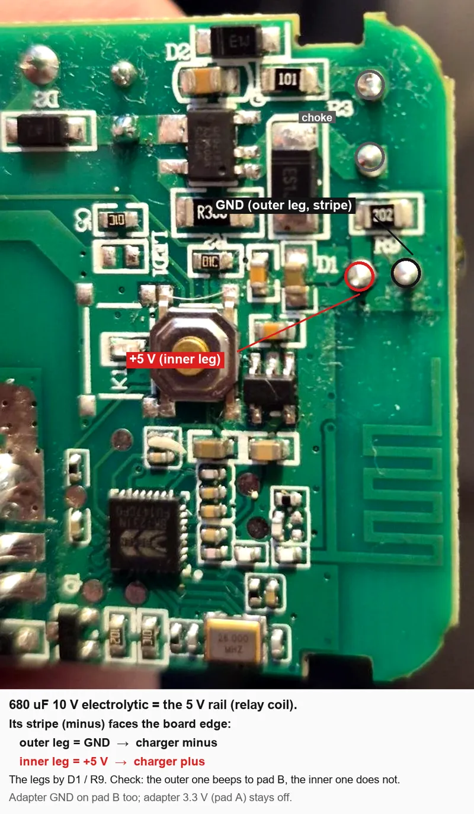

# In-wall relay 86-TDQ (CB2S-type module in a slot, Beken BK7231N) on ESPurna

A no-name in-wall 1-channel relay for AC 100-240 V: board printed **86-TDQ JINNOV2 2022.12.01**, terminals S2 S1 N N L
LOUT, a 16 A relay with a 5 V coil (Y32F-SS-105LMH), a button and a Wi-Fi LED. The Wi-Fi module (BK7231N, the stock
config calls it CB2S) stands upright in the slot U3, front row labelled CEN ADC P8 P7 P6. 2 MiB flash with a Tuya
bootloader of another build than the CB3S / CBU ones (CRC32 `6802f257`, same partitions); the firmware knows it since
2026-11-07. No Matter factory data on the chip: Matter makes its own identity.

<p>
  
  
  
  
</p>

**Safety.** Treat the low-voltage side as not isolated from the mains (as on the other in-wall boards, not measured here). Flash and debug only
with the mains disconnected, from 5 V. Never connect the USB-UART adapter while it is on 230 V.

## Image and pins

`beken-matter`. Pins from the stock config (`user_param_key` of the dump, [bk7231tools](https://github.com/tuya-cloudcutter/bk7231tools) `dissect_dump`):

| Function | Pin | Keys |
|----------|-----|------|
| relay (active high) | P8 | `relayGpio0 8` |
| Wi-Fi LED (active low) | P7 | `ledGpio0 7`, `ledInv0 1` |
| button (active low) | P10 (RX1) | `btnGpio0 10`, `btnMode0 pushbutton`, `btnPinMode0 pull-up`, `btnDefVal0 high`, `btnRelay0 0` |
| wall switch S1 / S2 | P26 | `btnGpio1 26`, `btnMode1 switch`, `btnPinMode1 pull-up`, `btnDefVal1 initial`, `btnRelay1 0`, `btnPress1 relay-toggle`, `btnRlse1 relay-toggle` |

The button sits on P10, the RX pin of UART1: the serial port leaves it to the button by itself and keeps TX (P11) for
the log, no `uartRx0` key needed.

## Flashing

- **Power: 5 V on C3**, the 470 µF / 10 V electrolytic next to the slot (the relay coil rail), its minus is GND. The
  3.3 V pin of a USB-UART adapter is enough to read and write the flash, but not for ESPurna to start Wi-Fi: it stays
  silent until the board gets its 5 V.
- **UART1** on the module pins (TX1 / RX1, GND). **CEN** is the first pin of the front row, there is also a CEN test pad
  on the back of the module; the bootloader caught the link without touching it here.
- **Speed:** writing at the default 115200 failed twice at the same point after about 1 min 50 s (`No response
  received` at 0x100000); at `-b 921600` it took 27 s:

```
ltchiptool flash read -d COM3 -t 60 bk7231n stock.bin
ltchiptool flash write -d COM3 -b 921600 -t 60 espurna-beken-initial-tuya.uf2
```

Then upload `espurna-beken-matter.bin` once over Wi-Fi for the Matter code (the board, already on that build, takes
the Matter code out of it), or let *ADMIN → From GitHub* do both uploads.

## Tested

Backup (2 MiB, stock dump kept locally), UART flash, first boot, Wi-Fi, the bootloader recognized (OTA at 0x12A000),
pins from the stock config, UART RX released to the button, update over Wi-Fi in two uploads (`OK, again`, then the
Matter code), Matter started with its own identity, the relay switches.

## The same relay with the chip on the board (bare BK7231N QFN32)

A square 1-channel relay of the same kind: 16 A relay with a 5 V coil (FANHAR FH17-1A2TLE), a 6-screw terminal block,
a button K1, a Wi-Fi LED, a wall switch input. Here the BK7231N (QFN32, 26 MHz crystal, PCB antenna) is soldered
straight on the board, no module, so there are no module pins: the factory left round test pads next to the chip
instead. The stock config still calls it CB2S. Stock firmware `oem_bk7231n_control_switch` 1.3.10 (Tuya SDK 2.3.3),
the standard Tuya bootloader (CRC32 `f684a1dc`, as on CB3S / CBU), 2 MiB flash.

<p>
  
  
</p>

**Test pads** (chip pin 1 is the corner next to the crystal and the antenna; pin numbers of the QFN32):

| Pad | Signal | Chip pin |
|-----|--------|----------|
| A | 3V3 | |
| B | GND | |
| D | TX1 (P11) | 27 |
| E | RX1 (P10) | 26 |
| F | CEN | 21 |
| C | P21, not used by the stock config | 19 |

**Power: 5 V on the 680 µF / 10 V electrolytic** (the relay coil rail). Its legs are the two round joints by D1 / R9;
the stripe faces the board edge, so the outer leg is GND and the inner one +5 V. Leave the 3.3 V of the USB-UART
adapter off.

**Pins** from the stock config:

| Function | Pin | Keys |
|----------|-----|------|
| relay (active high) | P7 | `relayGpio0 7` |
| Wi-Fi LED (active high) | P26 | `ledGpio0 26`, `ledInv0 0`, `ledMode0 wifi` |
| button K1 (active low) | P23 | `btnGpio0 23`, `btnMode0 pushbutton`, `btnPinMode0 pull-up`, `btnDefVal0 high`, `btnRelay0 0` |
| wall switch | P6 | `btnGpio1 6`, `btnMode1 switch`, `btnPinMode1 pull-up`, `btnDefVal1 initial`, `btnRelay1 0`, `btnPress1 relay-toggle`, `btnRlse1 relay-toggle` |

Flashing as above: read the stock flash first, then `espurna-beken-initial-tuya.uf2` over UART1 (CEN to GND at
"Connecting"), then `espurna-beken-matter.bin` over Wi-Fi.

Tested: stock backup, UART flash of the release image, Wi-Fi, the relay from the terminal, the Matter code over Wi-Fi
(`MATTER.TAIL`: ready). Not tested yet: the button and the wall switch, Matter pairing.
