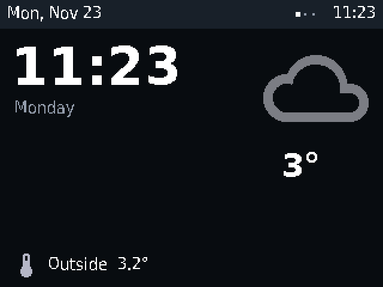
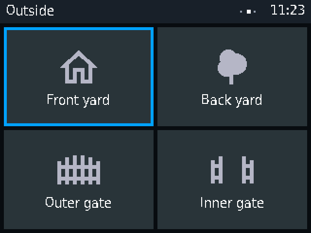
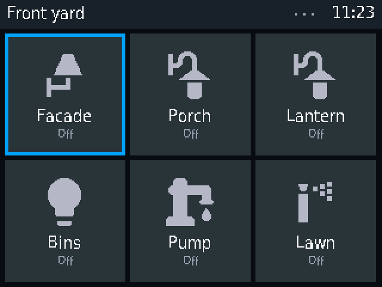
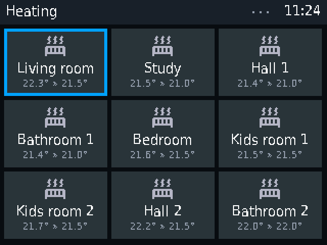
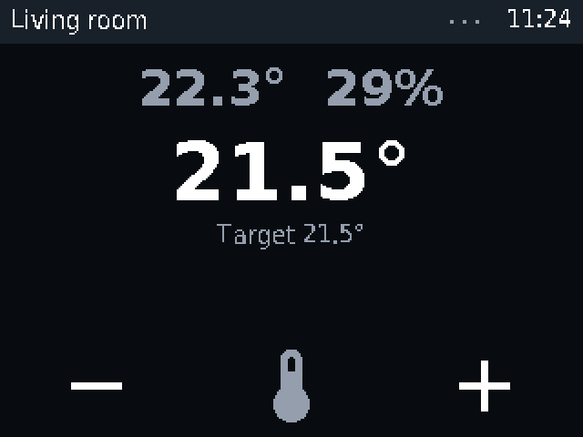
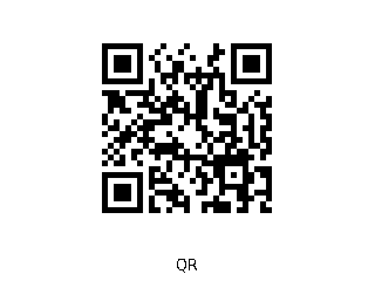

# Screens: the screen module and its panels

One implementation of everything a screen of a board does, on every chip (ESP32, Beken, ESP8266): the `screen`
module. The modules that drive a display are its **panels**, named by the technology they talk to, not by a product:

| Module | What it is | Needs |
|--------|------------|-------|
| `screen` | the drawing (boxes, lines, circles, text, icons), the fonts and icons, the pages of lines, the tile pages of `/nspanel.json`, the Matter QR page, blanking, the keys, the WebUI mirror | `tls`, `http`, `tools` |
| `oled` | SSD1306 / SH1106 on I2C, 1 bit, 128x64 .. 64x32 | `screen`, `i2c` |
| `lcd` | a colour TFT on SPI: ILI9341, ILI9342 (the M5Stack), ST7789 | `screen`, `spi` |
| `nextion` | a Nextion display on a UART (the Sonoff NSPanel's: the OHpanel and Lovelace UI TFTs, detected), its TFT upload | `screen`, `uart`, `tls`, `http` |

One panel at a time. A pixel panel (`oled`, `lcd`) is drawn by the screen module; the Nextion draws its own pages and
the screen draws on it only its QR page.



The pictures on this page are what an M5Stack Basic (`lcd`, ILI9342, 320x240) shows, pixel for pixel: the screen's
drawing commands with the firmware's own fonts and icons.

## What the screen shows

### The tile pages (`/nspanel.json`)

The pages of tiles of the NSPanel configuration: entities on MQTT topics and relays, groups and scenes, thermostats,
the weather (Open-Meteo), the info lines and the room temperature (the first temperature of the ESPurna sensors). The
format is the one of the NSPanel, [nspanel/reference.md](../nspanel/reference.md); the PAGES panel of the WebUI edits
and previews it, `POST /nspanel.json` uploads it.

Two displays show them:

- **the Nextion** of the `nextion` module (the NSPanel): its OHpanel or Lovelace UI TFT draws them, touch and swipes;
- **the light display** of the screen module, on any pixel panel, once a configuration is stored: drawn by the
  ESP itself, three keys instead of a touch.

The light display:

| | |
|---|---|
|  | **Home**: the clock, the weekday, the weather now (its icon 96 px where the screen takes it), the room temperature, the info lines. The header: the date, where the card is in the row, the time. |
|  | **A card**: the tiles of a page in its `layout` (4x2, 3x3, 3x2, 2x2, 1x2; a screen under 120 px: two a card), a frame around the chosen one. A tile that is on is light. |
|  | **A nested page** (a tile's `page`): opened by its tile, *back* returns to the card it came from. |
|  | **Thermostats** on a 3x3 page: the room temperature and the target on each tile. |
|  | **A thermostat**: the room now and its humidity, the target large, minus and plus over the keys A and C. The target is sent 3 s after the last key, or when the card closes. |

The keys (`SCREEN.KEY prev | next | enter | back`, the WebUI's keys of the SCREEN panel, a button with a terminal
command action):

| Key | Home | A card | A thermostat |
|-----|------|--------|--------------|
| `prev` | the last card | the tile before; before the first: the card before (home after the first card) | target - step |
| `next` | the first card | the next tile; after the last: the next card | target + step |
| `enter` | the first card | the tile: a switch toggles, a button presses, a scene, a page opens, a thermostat opens | send, close |
| `back` | — | home (a nested page: the card it was opened from) | send, close |

A blanked or dimmed screen only wakes up on a key. Blanking follows the configuration's `screensaver`: `timeout`
seconds, then `dim` % (0: off), `brightness` % while on.

The screen draws again only what changed: a tile when its state, value or the frame changed, a part of home when its
text changed; a WebUI that connects gets the picture without the panel being drawn again. A configuration applied again
keeps the card that is on the screen.

What the light display does not have of the OHpanel's: the weather forecast page, the history charts, the settings
tiles, the backgrounds and themes (one dark theme; a 1-bit panel: white on black).

### The lines

Without a tile configuration a pixel panel shows up to 8 lines of a label and a source, in pages:

| Setting | |
|---------|---|
| `scrLbl0..7` | the label of a line, on the left |
| `scrSrc0..7` | what it shows on the right: `time`, `date`, `datetime`, `ip`, `ssid`, `rssi`, `host`, `uptime`, `heap`, `wifi`, `mqtt`, `relay:<id>`, `sensor:<index>` or `sensor:<type>` (`sensor:temperature`), `mqtt:<topic>` or `mqtt:<topic>#<json key>` |
| `scrFont` | `10`, `16`, `24`: small, normal, large lines (13, 17, 23 px) |
| `scrPage` | seconds a page stays when the lines take more than one (5) |
| `scrOff` | seconds to blank, 0 never (0) |
| `scrBright` | brightness, % (100) |
| `scrMatter` | the Matter QR page while the pairing window is open (1) |

A row is drawn again only when what it shows changed. The `oled*` line settings of the older oled module become these
once.

### The Matter QR page



While the Matter pairing window is open (MATTER.WINDOW, the MATTER panel, a controller asking, the tile action
`matter-pair`) the screen shows the QR code of the pairing payload and the manual code over whatever it shows; a key
or a touch of the NSPanel takes it away until the next window. `SCREEN.QR` shows the Matter code for a minute, `SCREEN.QR
<text>` a QR code of the text (the picture above), `SCREEN.QR off` takes it away. The codes carry the setup passcode:
drawn on the screen and the WebUI mirror only, never printed or logged.

## Boards

### M5Stack Basic / Gray

Modules: `screen`, `lcd`, `spi`, `button`, `mqtt`, `ntp`, `tls`, `http` (and `i2c` for the IP5306 power chip). Settings:

```
lcdType ili9342
lcdCS 14
lcdDC 27
lcdRst 33
lcdBL 32
lcdInv 1                     # the newer ILI9342C: without it the dark background shows white
btnGpio0 39
btnGpio1 38
btnGpio2 37
btnDefVal0 high              # btnDefVal1, btnDefVal2 the same
btnPress0 term-cmd           # btnPress1, btnPress2 the same
btnClick0 none               # btnClick1, btnClick2 the same
btnTermCmd0 "screen.key prev"
btnTermCmd1 "screen.key enter"
btnTermCmd2 "screen.key next"
```

The SPI bus is the ESP32's default (SCK 18, MOSI 23, MISO 19). Then upload a tile configuration in the PAGES panel.
The IP5306 switches the board off at a light load unless its keep-on bit is set (not done by ESPurna yet): a board on
USB may go silent after a reset. Its LCD has no read line: `GET /screen.raw` answers 501 there.

### Any SPI TFT (ESP32, Beken)

| Setting | |
|---------|---|
| `lcdType` | `ili9341`, `ili9342`, `st7789` (none: no panel) |
| `lcdSize` | the controller's own width x height (ILI9341 / ST7789 240x320, ILI9342 320x240) |
| `lcdRot` | 0..3, quarter turns |
| `lcdBgr` | blue and red swapped (default: ILI934x yes, ST7789 no) |
| `lcdInv` | colours inverted (default: ILI934x no, ST7789 yes) |
| `lcdCS`, `lcdDC` | chip select, data / command (both needed) |
| `lcdRst`, `lcdBL` | reset, backlight (on when high; dimmed by PWM with the `light_pwm` module) |
| `lcdMHz` | the SPI clock (40) |

The bus: `spiSCK`, `spiMOSI`, `spiMISO` of the `spi` module. Beken has no hardware SPI port in ESPurna: its software SPI
runs as fast as the pins go above 500 kHz, a full 320x240 screen takes a while. The panel and the pins apply at boot.
`LCD.ID` prints what the controller answers to its read commands (all `FF`: no read line).

### OLED

`oledType` (`ssd1306`, `sh1106`), `oledSize` (`128x64`, `128x32`, `64x48`, `64x32`), `oledAddr` (`0x3c`), `oledFlip`,
`oledRst`; the bus is `i2cSDA` / `i2cSCL` of the `i2c` module. `OLED` prints its pixels in the terminal.

### Sonoff NSPanel (the `nextion` module)

The NSPanel module of the older images is now two: `screen` (the tile pages) and `nextion` (the display). Its settings
keep their names (`nspPort`, `nspPower`, `nspBuzzer`, `nspIcons`, `nspTheme`), as do `/nspanel.json`, the MQTT topic
`<root>/nspanel` and the commands `NSPANEL.INFO`, `NSPANEL.RELOAD`, `NSPANEL.PAGE`, `NSPANEL.SEND`, `NSPANEL.DETECT`,
`NSPANEL.FLASH`, `NSPANEL.CAPTURE`, `NSPANEL.EVENT`, `NSPANEL.URL`. `NSPANEL.QR` is `SCREEN.QR` now. Updating a panel:
switch on `screen` and `nextion` instead of `nspanel`, then upload its `/nspanel.json` again (the configuration is kept
in the flash data of the screen module now).

### The configuration across head updates

The tile configuration is in the flash data of the screen module, at the top of the module area. A head update keeps it:
on ESP32 the running head writes the package of the new head under the data of the modules (named in the RBL header),
the bootloader keeps the old head for the rollback under the package; an ESP8266 of 2 MB and more has the data in its
upper area and the package in its top zone. An ESP8266 of 1 MB refuses a head update while a module keeps data there
(remove the module, update, install it and upload the configuration again). The head that does the update decides
where the package goes: the update that brings this behaviour is done by an older head, upload the configuration once
more after it.

## WebUI

| Panel | Module | |
|-------|--------|---|
| SCREEN | `screen` | the mirror of the screen and its keys, the lines, blanking, the QR page |
| PAGES | `screen` | the tile configuration: editor, preview, upload |
| OLED | `oled` | the controller, the size, the address, the pins |
| LCD | `lcd` | the controller, the size, the rotation, the colours, the pins |
| NEXTION | `nextion` | the driver, the TFT upload, the mirror of the Nextion |

## Pictures of a screen

`GET /screen.raw` (the WebUI login): `<width> <height>`; `?y=<row>&h=<rows>` (16 at most): those rows as the panel
shows them, RGB565 big-endian, read from the panel (an OLED's buffer, an SPI TFT's video memory where its read line is
wired). Where it is not, the WebUI mirror carries the drawing commands; rasterized with the fonts and icons of
`screen_fonts.h` / `screen_icons.h` they give the same pixels: the pictures of this page.

## Fonts and icons

`code/scripts/screen_fonts.py` generates `screen_fonts.h` (DejaVu Sans Condensed 10 / 14 / 19 px with Latin-1 and
Cyrillic, DejaVu Sans Bold 28 / 44 px digits and signs) and `screen_icons.h` (every icon code of
`screen_pages_icons.h` from the Material Design Icons font, 24 and 48 px, the weather icons also 96 px). 1 bit a pixel,
the glyphs sorted by code (the screen finds them by a binary search). Run it again after a change of the icon table:

```
python code/scripts/screen_fonts.py --mdi <materialdesignicons-webfont.ttf> [--fonts C:/Windows/Fonts]
```

DejaVu: Bitstream Vera license (the notice is in `screen_fonts.h`); Material Design Icons: Pictogrammers Free License.

## Sizes

| Module | ESP32 | Beken | ESP8266 |
|--------|-------|-------|---------|
| `screen` | 259 KB | 203 KB | 234 KB |
| `nextion` | 98 KB | 74 KB | 96 KB |
| `lcd` | 8 KB | 6 KB | 8 KB |
| `oled` | 6 KB | 4 KB | 6 KB |
