# Sonoff NSPanel (gen1 EU) on ESPurna

ESPurna firmware for the first Sonoff NSPanel (EU, ESP32 + 3.5" Nextion touch screen). The panel works on its own: the screen,
the tiles and what they switch are described by one JSON file stored on the panel, and it talks MQTT directly to your devices.
No Home Assistant, no ioBroker, no AppDaemon or Berry scripts; any MQTT broker is enough, and the weather comes from Open-Meteo
without an API key.

What you get:

- a home screen with clock, date, current weather and forecast, room temperature, up to two info lines (any MQTT value, e.g.
  an outdoor thermometer) and up to seven shortcut icons;
- pages of tiles in grids of 8, 9, 6, 4 or 2 tiles (4x2, 3x3, 3x2, 2x2, 1x2) or as lists, with swipe navigation;
- tiles that open nested pages ("Outside" → "Back yard" → "Sockets");
- switches, pulse buttons (gates), scenes over groups of devices, read-only values, thermostats with a setpoint dial;
- any MQTT device: ESPurna / Tasmota style `.../relay/0` topics, zigbee2mqtt JSON, Istabai and other JSON payloads;
- the two hardware buttons can run a group action ("all lights off", "open both gates");
- a settings page on the panel itself (icon size, dark / light tiles, background);
- an editor with a live preview in the ESPurna web UI, OTA updates for both the ESP32 and the screen.

<p>
  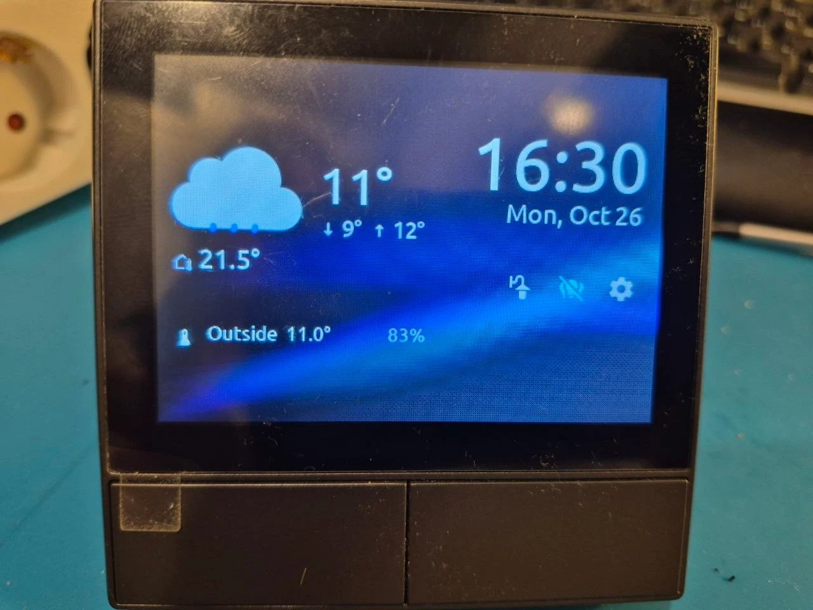
  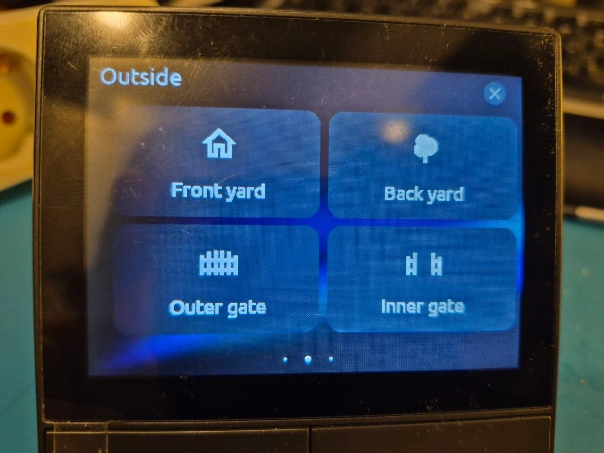
  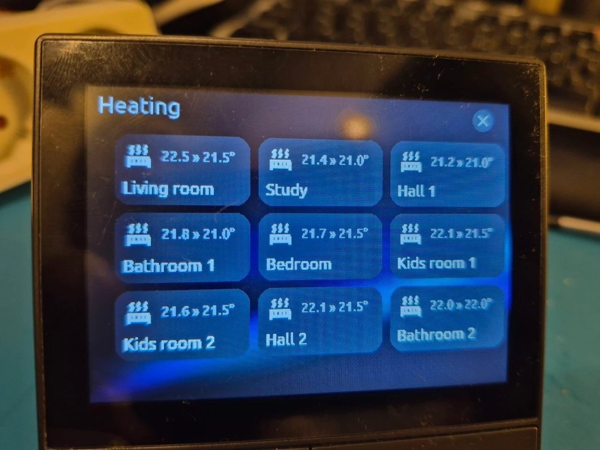
  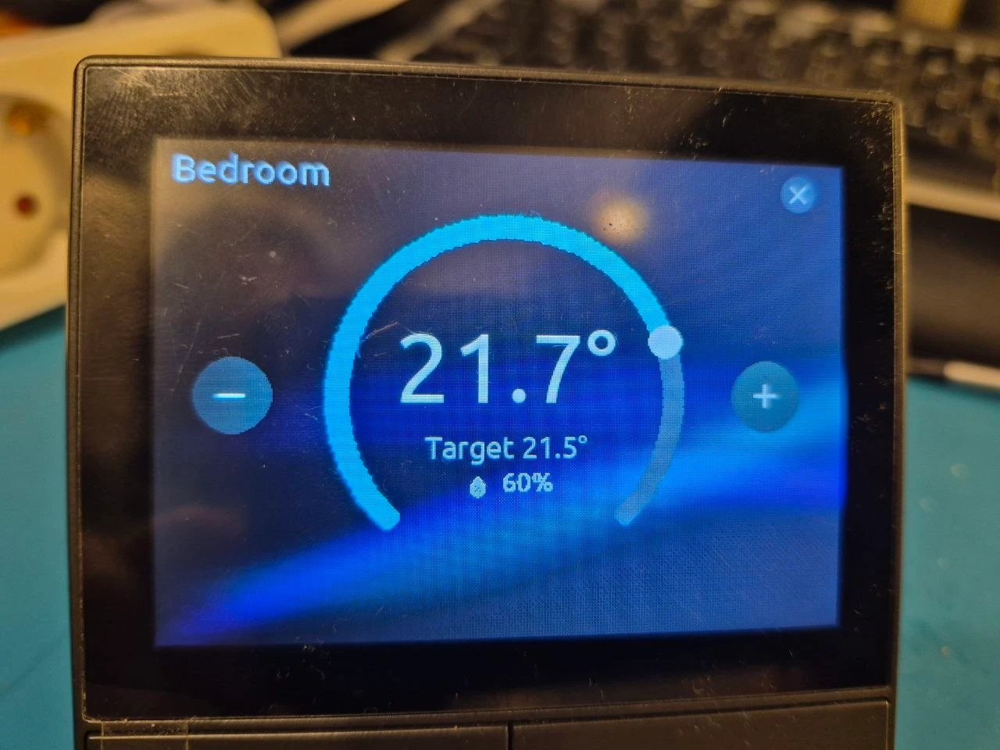
</p>

Everything below is the user guide. Every field, limit and protocol detail is in the [technical reference](reference.md).

## 1. What you need

- A Sonoff NSPanel **EU** (gen1). The US versions have a different screen layout and are not supported.
- A USB-UART adapter (3.3 V) for the first flash only. Later updates go over WiFi.
- An MQTT broker and devices that publish their state to MQTT.
- The firmware from this branch, PlatformIO environment `esp32-nspanel`:

  ```
  cd code
  pio run -c platformio_esp32.ini -e esp32-nspanel
  ```

  `espurna-esp32-nspanel.bin` is the full image for the serial flash, `firmware.bin` the image for later OTA updates.

## 2. Install

1. **Serial flash, once.** Open the panel and connect the adapter to the 5-pin header on the ESP32 board: 3V3, ESP_TX, ESP_RX,
   GND, IO0. Hold IO0 on GND while you power the adapter, then flash:

   ```
   esptool.py --chip esp32 --port COMx --baud 460800 write_flash --erase-all -z 0x0 espurna-esp32-nspanel.bin
   ```

   The screen stays dark on the adapter alone: it is powered by the 5 V of the relay board. Close the panel and power it from mains.
2. **Network.** The panel starts the usual ESPurna access point. Set WiFi, the admin password, the MQTT broker and the NTP time
   zone in the web UI, as on any ESPurna device.

   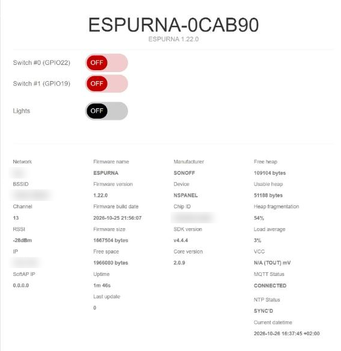

3. **Screen firmware (TFT).** Use the [OHpanel](https://github.com/bruestel/ohpanel) design: it has swipes, a nicer look and 5
   backgrounds. In the web UI open DEBUG (or connect with telnet) and run:

   ```
   nspanel.flash https://raw.githubusercontent.com/bruestel/ohpanel/ba9361982399414d1612aea85504d9707b329e75/boards/nspanel/nextion/display/ohpanel-nspanel-eu-display-bc629e1e.tft
   ```

   It takes about 6 minutes; do not cut the power meanwhile. The screen restarts by itself and the panel finds it. A panel that
   still has the Sonoff or Lovelace UI screen also works without this step, with fewer features (see the reference).
4. **Configuration.** Open the **NSPANEL** section of the web UI, paste your JSON (start from [`nspanel.example.json`](nspanel.example.json)),
   press **Save**. The panel checks it, stores it and redraws the screen at once.

Later firmware updates: web UI → ADMIN → Upgrade with `firmware.bin`, like any ESPurna device.

## 3. The configuration file

The whole screen is one JSON document. Its skeleton:

```jsonc
{
  "language":    "en",      // screen texts and dates: "en" (default) or "ru"
  "mqtt":        { ... },   // how your devices say "on" / "off"
  "screensaver": { ... },   // home screen: dimming, weather, shortcuts, info lines
  "ohpanel":     { ... },   // look: background, icon size, theme
  "pages":       [ ... ],   // the pages you swipe through, each with its tiles
  "groups":      { ... },   // named lists of devices for scenes and buttons
  "buttons":     [ ... ]    // what the two hardware buttons do
}
```

Only `pages` is really needed; everything else has defaults.

### 3.1 How your devices are switched

A tile points at the **state topic** of a device, the topic where the device publishes whether it is on:

```json
{ "name": "Kitchen", "icon": "ceiling-light", "topic": "ESPURNA-KITCHEN/relay/0" }
```

The panel subscribes to that topic, colours the tile by the state and, on a tap, publishes the new value to the command topic.
By default the command topic is the state topic + `mqtt.set`, and the values are `mqtt.on` / `mqtt.off`. For ESPurna devices:

```json
"mqtt": { "on": "1", "off": "0", "set": "/set" }
```

so a tap on "Kitchen" sends `0` or `1` to `ESPURNA-KITCHEN/relay/0/set`. For other devices set the values per tile:

```jsonc
// zigbee2mqtt: the state is JSON {"state":"ON",...}, the command is {"state":"OFF"} to <name>/set
{ "name": "Desk lamp", "icon": "lamp",
  "topic": "zigbee2mqtt/DeskLamp", "path": ["state"], "on": "ON", "off": "OFF",
  "command": "zigbee2mqtt/DeskLamp/set", "payload": "{\"state\":\"%s\"}" }
```

- `path` picks a value out of a JSON payload: `["state"]`, `["temperature"]`, `["Living room", "set_temperature"]`.
- `command` is an explicit command topic, `payload` a template where `%s` becomes the value.
- `relay: 0` instead of `topic` switches a relay of the panel itself.

### 3.2 Tile types

| `type` | Tap does | Tile shows |
|---|---|---|
| `switch` (default) | toggles on / off | on / off colour |
| `button` | sends `on` once (pulse relays: gates, doorbells) | lights up for a second |
| `scene` | `action` (`on` / `off` / `toggle`) on all devices of `group` | on while any device of the group is on |
| `text` | nothing | the value of the topic (a sensor) |
| `thermostat` | opens the thermostat dial | `21,9° » 21,5°` (current » target), orange while heating |

A tile that opens a page has no `type`: it has `page` (a nested page, see 3.4) or `open` (`"settings"`, `"weather"`, `"home"`
or the `id` of a top-level page).

**Icons** are [Material Design Icons](https://pictogrammers.com/library/mdi/) names: `ceiling-light`, `outdoor-lamp`, `gate`,
`water-pump`, `radiator`, `string-lights`, `power-socket-eu`, ... The built-in names are listed in
[`nspanel_icons.h`](../code/espurna/nspanel_icons.h); an unknown name shows a warning sign and is reported when you save. Any
other MDI icon works as a code: take its codepoint from the MDI site, subtract `F0001`, add `E000` (`lightbulb` F0335 → `"E334"`).

**Names** have to be short: about 8 Cyrillic or 10 Latin letters fit a tile of the 8-tile grid, more on the bigger tiles. Longer
names are cut with `...`.

### 3.3 Pages and layouts

`pages` are the screens you swipe through, from left to right after the home screen:

```json
"pages": [
  { "title": "Outside", "layout": "2x2", "items": [ ... ] },
  { "title": "House",   "layout": "2x2", "items": [ ... ] }
]
```

| `layout` | Tiles per screen | Good for |
|---|---|---|
| `4x2` (default) | 8 | many lights in a room |
| `3x3` | 9 | thermostats, many small things |
| `3x2` | 6 | a medium group, bigger tiles |
| `2x2` | 4 | menus ("Ground floor / First floor / Heating") |
| `1x2` | 2 | two wide rows |

<p>
  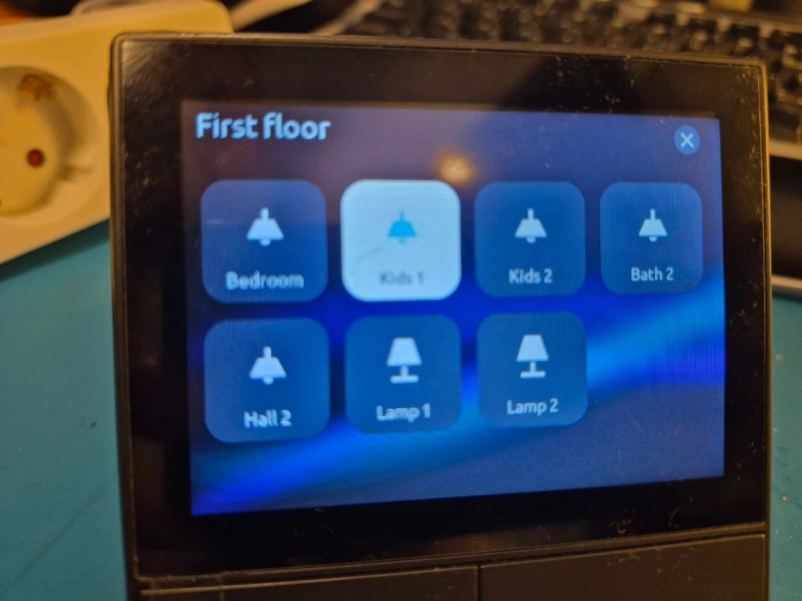
  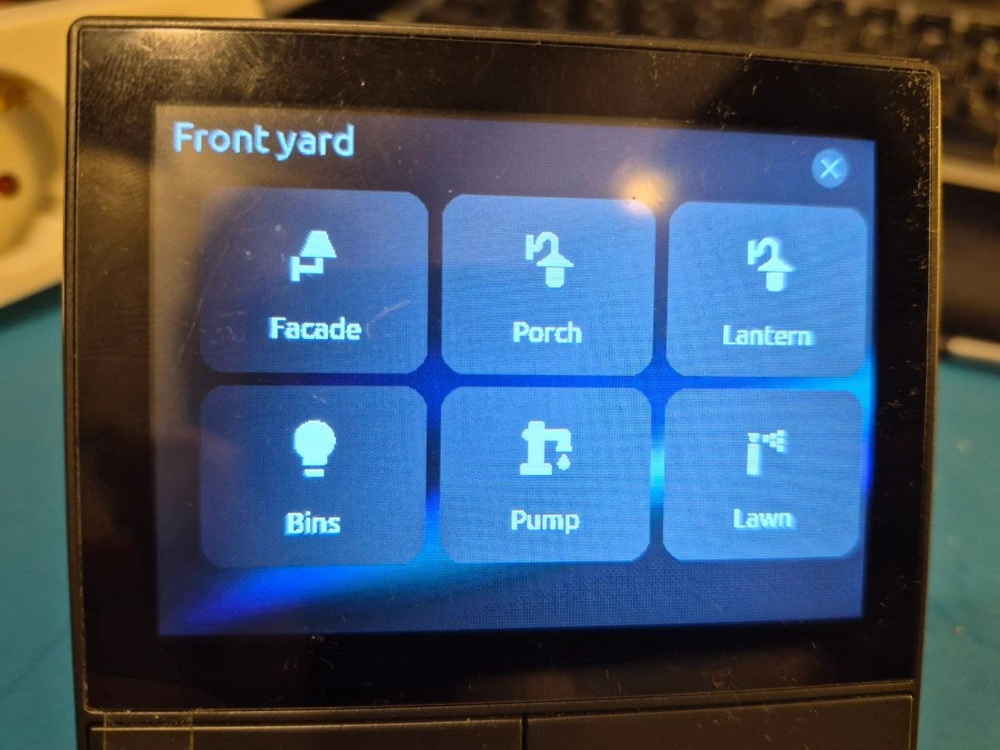
  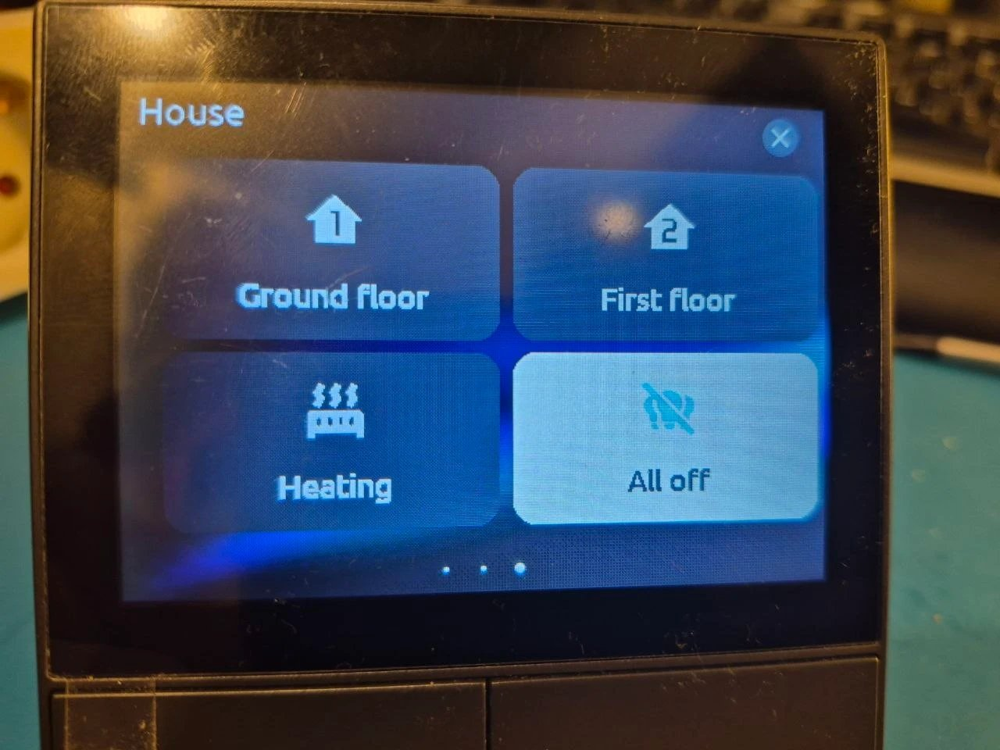
</p>

A page with more tiles than fit is split into sheets (`Outside 1/2`, `Outside 2/2`). `"per_screen": 5` limits how many tiles a
screen gets. `"type": "list"` shows the page as rows (7 per sheet) with the state written on the right.

### 3.4 Nested pages

Put a `page` inside a tile instead of a topic, and the tile opens it. The nested page is not in the swipe row; the cross (or a
swipe right) returns to where you came from. Nesting can go deeper:

```jsonc
{ "title": "Outside", "layout": "2x2", "items": [
  { "name": "Back yard", "icon": "tree", "page": {
      "layout": "3x2",
      "items": [
        { "name": "Garland", "icon": "string-lights", "topic": "ESPURNA-TERRACE/relay/0" },
        { "name": "Sockets", "icon": "power-socket-eu", "page": {
            "layout": "2x2",
            "items": [ { "name": "Socket 1", "icon": "power-socket-eu", "topic": "ESPURNA-SOCKETS/relay/0" } ]
        } }
      ]
  } },
  { "name": "Outer gate", "icon": "gate", "topic": "ESPURNA-GATE1/relay/0", "type": "button" }
] }
```

<p>
  
  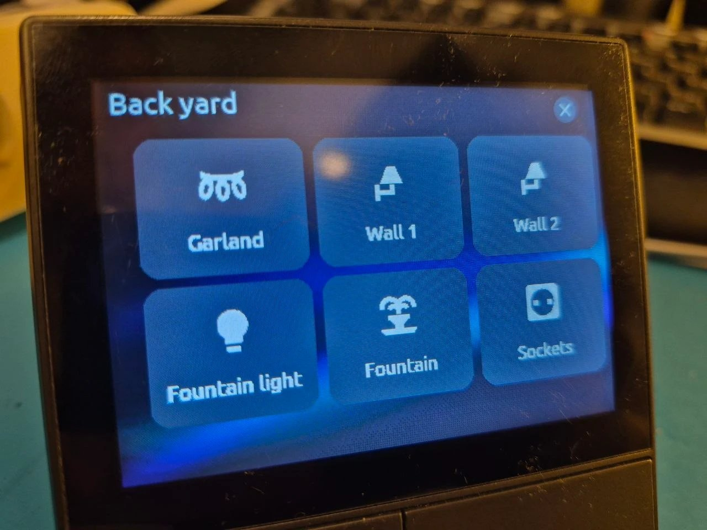
  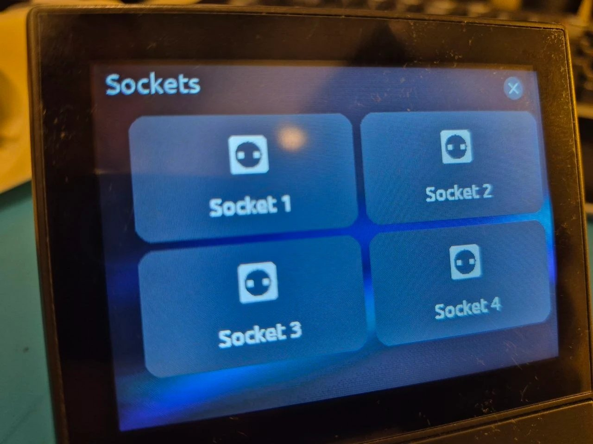
</p>

The nested page takes the tile name as its title. This keeps the swipe row short: home → Outside → House, and everything else
is one tap away.

### 3.5 Groups, scenes and the hardware buttons

A group is a named list of state topics (or local relay numbers):

```json
"groups": {
  "house": [ "ESPURNA-KITCHEN/relay/0", "ESPURNA-HALL/relay/0", "zigbee2mqtt/DeskLamp" ],
  "gates": [ "ESPURNA-GATE1/relay/0", "ESPURNA-GATE2/relay/0" ]
}
```

A `scene` tile runs an action on the whole group: `{ "name": "All off", "icon": "lightbulb-group-off", "type": "scene",
"group": "house", "action": "off" }`. `toggle` means "any on → all off, else all on".

The two buttons under the screen run `buttons[0]` (left) and `buttons[1]` (right):

```json
"buttons": [ { "group": "house", "action": "off" }, { "group": "gates", "action": "on" } ]
```

A button follows the JSON only when its ESPurna click action is `custom`. The right button is `custom` out of the box; the left
one toggles the panel's own relay 1 until you run `set btnClick0 custom` and `reset` in the terminal. A button can also run `{ "relay": 0 }`, `{ "topic": "...", "action": "toggle" }` or open a
page, `{ "page": 1 }`.

### 3.6 Home screen

```jsonc
"screensaver": {
  "timeout": 60,                 // seconds without a touch until the panel goes home and dims
  "brightness": 100,             // brightness while in use, 1..100
  "dim": 10,                     // brightness when idle, 0 = backlight off
  "weather": { "lat": 52.52, "lon": 13.40, "refresh": 900 },
  "shortcuts": [                 // up to 7 icons on the home screen, each a tile without a name
    { "icon": "outdoor-lamp", "type": "scene", "group": "outdoor", "action": "toggle" },
    { "icon": "lightbulb-group-off", "type": "scene", "group": "house", "action": "off" },
    { "icon": "cog", "open": "settings" }
  ],
  "info": [                      // up to 2 lines with any MQTT value
    { "icon": "thermometer", "text": "Outside", "topic": "zigbee2mqtt/Outdoor thermometer",
      "path": ["temperature"], "format": "%.1f°", "extra": { "path": ["humidity"], "format": "%.0f%%" } }
  ]
}
```

`lat` / `lon` are your location for the weather. A tap on the weather picture opens the forecast for 7 days.

<p>
  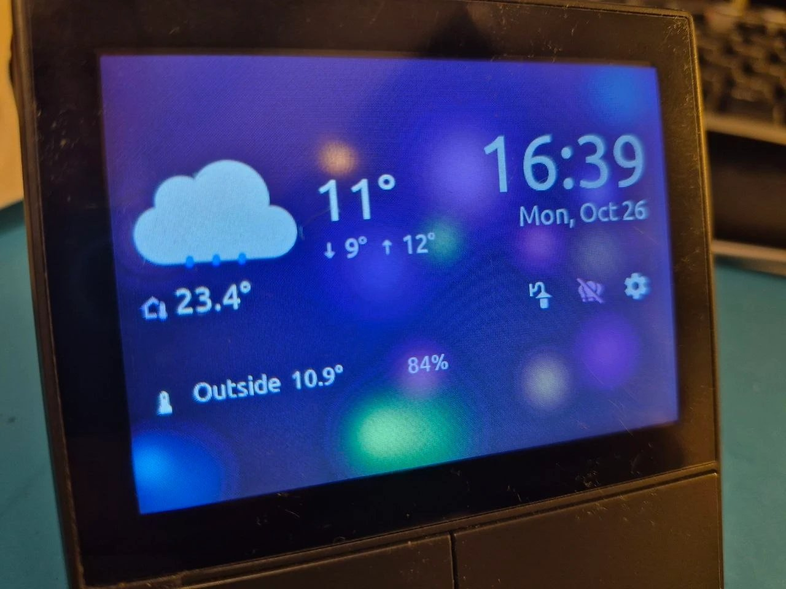
  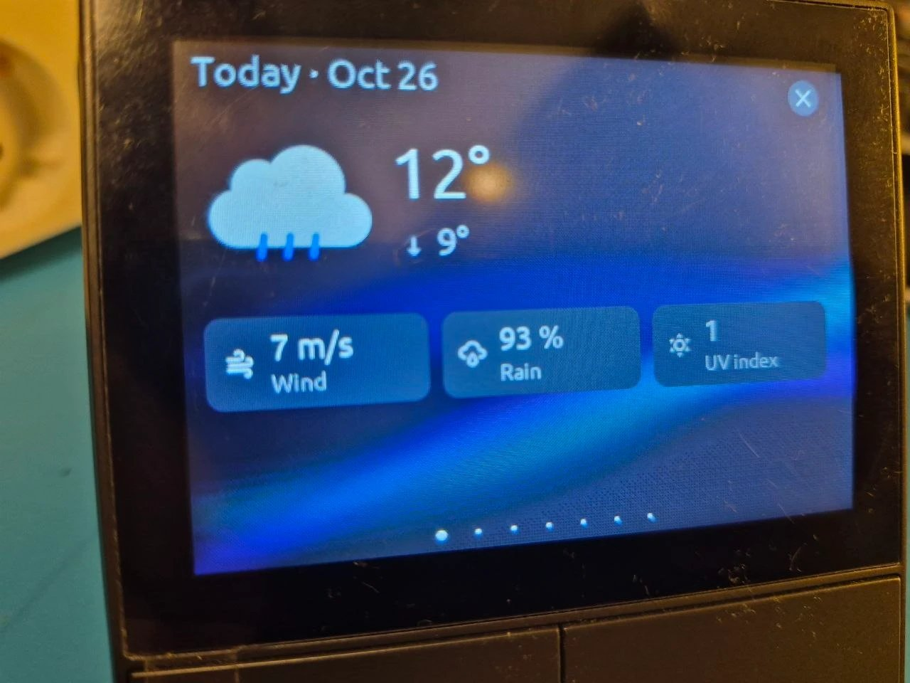
</p>
A shortcut can also be the name of an existing tile: `"shortcuts": ["Kitchen"]`.

### 3.7 Thermostats

A thermostat tile reads the current temperature, the target and whether it heats from one JSON topic, and sends the new target
when you change it on the dial (minus / plus, sent 1.5 s after the last tap):

```jsonc
// Istabai-style: one topic for all rooms {"Living room": {"temperature": 21.9, "set_temperature": 21.5, "active": "heat", ...}}
{ "name": "Living room", "icon": "radiator", "type": "thermostat",
  "topic": "istabai/out", "room": "Living room", "command": "istabai/in/Living room", "step": 0.5 }

// zigbee2mqtt radiator valve: explicit paths
{ "name": "Bedroom", "icon": "radiator", "type": "thermostat", "topic": "zigbee2mqtt/Bedroom TRV",
  "current": ["local_temperature"], "setpoint": ["occupied_heating_setpoint"], "active": ["running_state"],
  "min": 5, "max": 30, "step": 0.5,
  "command": "zigbee2mqtt/Bedroom TRV/set", "payload": "{\"occupied_heating_setpoint\":%s}" }
```

Nine rooms fit one `3x3` page. A JSON payload for many rooms can be larger than ESPurna's default MQTT buffer (1 KB); the NSPanel
build raises it to 2 KB. If thermostats stay at `--`, check `nspanel.info` for a warning about it.

### 3.8 Look and the settings page

```json
"ohpanel": { "background": "aurora", "layout": "center", "theme": "dark" }
```

- `background`: `aurora`, `black`, `candy`, `dunes` or `forest`;
- `layout`: `center` (big icon in the middle, name below) or `corner` (small icon in the corner, room for the state);
- `theme`: `dark` (dark tiles, white when on) or `light` (white tiles, dark when on).

`"language": "ru"` (top level) switches the panel's own texts to Russian: dates, `On` / `Off`, the thermostat and weather
pages, the settings page, and a decimal comma (`21,5°`). Your tile names are shown as you wrote them.

The same three can be changed on the panel: a shortcut or tile with `"open": "settings"` shows the settings page (Icons, Theme,
Backdrop); a tap on a tile switches to the next choice. A choice made there is kept across reboots and wins over the JSON.

<p>
  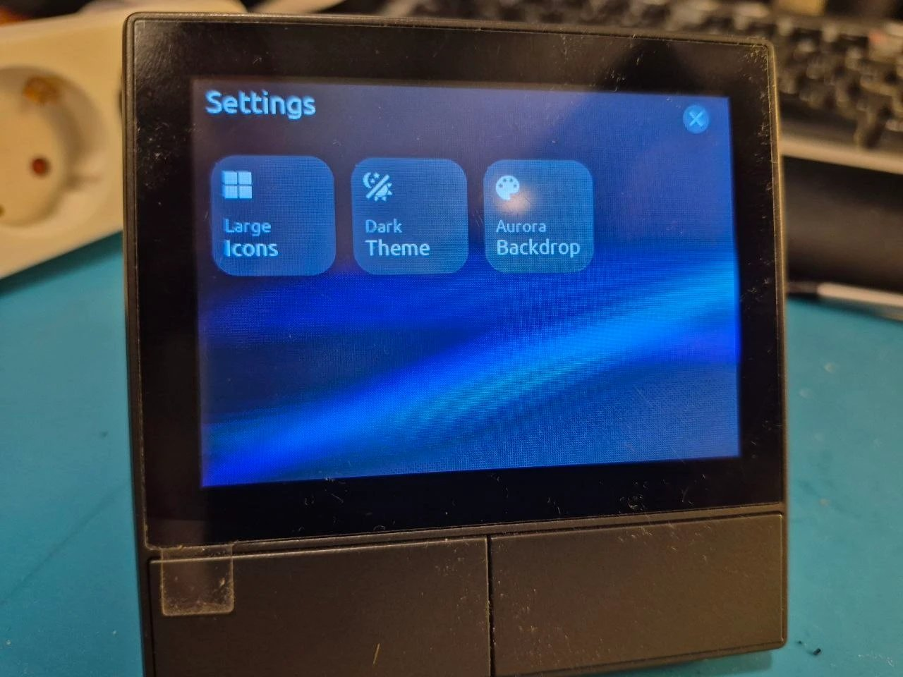
  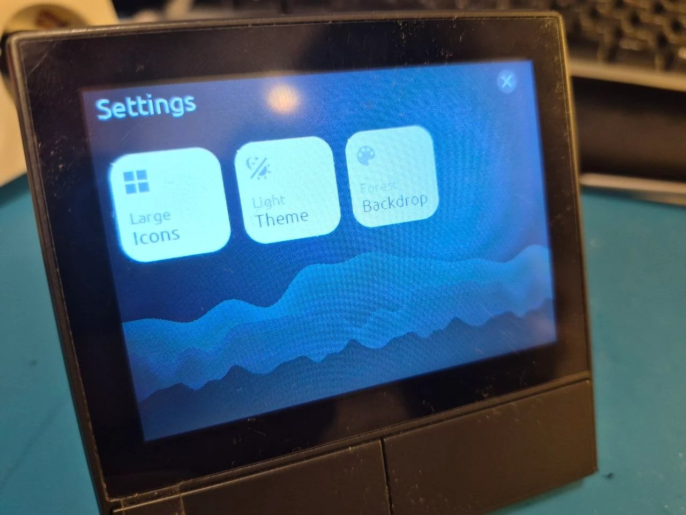
</p>

## 4. Using the panel

- **Swipe left / right**: next / previous page. **Swipe up / down** or the **cross**: home (on a nested page the cross goes back).
- **Tap** a tile: switch, scene, open a page or a thermostat.
- After `timeout` seconds without a touch the panel goes home and dims. The first tap on a dark screen only wakes it.

## 5. Editing, saving, checking

<p>
  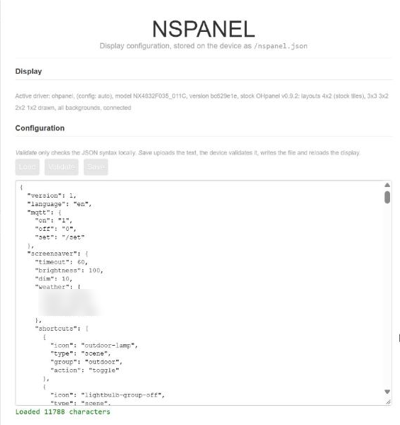
  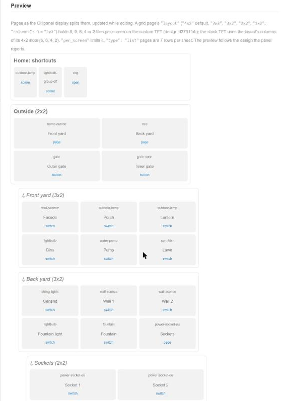
</p>

- **Web UI → NSPANEL**: Load, edit, Validate (syntax only), Save. The preview under the editor shows how the pages will be split.
  A save that fails shows the reason (`page 1 item 'Kitchen': needs "topic" or "relay"`) and leaves the old config in place.
  Warnings (an unknown icon, a wrong layout name) are shown, and the file is saved anyway.
- **From a script**: `POST /nspanel.json` with the JSON as the body and the web password (HTTP digest), e.g.

  ```
  curl --digest -u admin:<password> -H "Content-Type: application/json" --data-binary @nspanel.json http://<panel>/nspanel.json
  ```

  An answer `503 ... retry` means the panel was busy (weather download); send it again.
- **Size**: at most 16 KB, spaces and line breaks included. A large config fits easily when the indentation is kept small or
  the file is minified before upload.

Terminal commands (web UI DEBUG or telnet):

| Command | |
|---|---|
| `nspanel.info` | what the panel is doing: screen, config summary (pages, tiles, subscriptions), errors, weather, temperature |
| `nspanel.page 1` / `home` / `weather` / `settings` | show a page |
| `nspanel.reload` | read the stored JSON again |
| `nspanel.flash <url>` | update the screen firmware (TFT) |
| `reset` | restart the panel |

## 6. Credits

- Screen design: [OHpanel](https://github.com/bruestel/ohpanel) by bruestel (Apache-2.0); the extra grid pages for our own TFT
  build are in the fork [igorufox/ohpanel](https://github.com/igorufox/ohpanel/tree/espurna-grids).
- Older screen design: [NSPanel Lovelace UI](https://github.com/joBr99/nspanel-lovelace-ui) by joBr99.
- Icons: [Material Design Icons](https://pictogrammers.com/library/mdi/). Weather: [Open-Meteo](https://open-meteo.com/).
